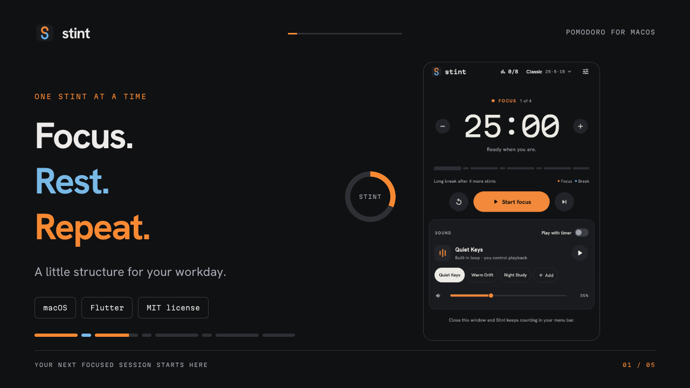
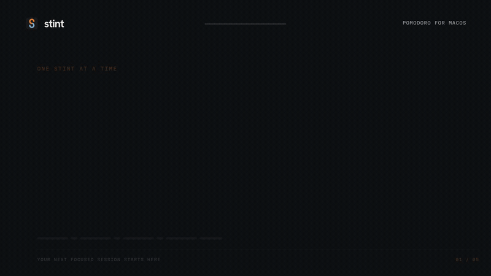

<p align="center">
  
</p>

<h1 align="center">Stint</h1>
<p align="center">One stint at a time. A focused Pomodoro app for your Mac.</p>
<p align="center">
  <a href="https://stint-focus.vercel.app/">Website</a> ·
  <a href="LICENSE">MIT license</a> ·
  <a href="https://github.com/albert2704/stint/releases/tag/v0.1.1">Download for Mac</a> ·
  <a href="docs/user-guide.md">User guide</a> ·
  <a href="docs/development.md">Build from source</a> ·
  <a href="CONTRIBUTING.md">Contribute</a>
</p>



Stint keeps your countdown in the macOS menu bar, pairs focus sessions with music, and makes breaks part of the same rhythm. It is built with Flutter and native macOS integrations. Your timer and history stay local; no Stint account is required.

Explore the [Stint website](https://stint-focus.vercel.app/) for an animated feature tour, light and dark previews, FAQs, and the Mac download. The website's countdown illustrates the app; focus sessions run in the installed macOS app.

**macOS preview:** macOS 12 or later, with one universal app for Apple Silicon and Intel. This preview is ad hoc signed and **not notarized by Apple**, so macOS may block the first launch. Physical Intel testing remains unverified. Android is not currently supported.

## Download and install

[**Download Stint 0.1.1 for Mac (.dmg)**](https://github.com/albert2704/stint/releases/download/v0.1.1/Stint-0.1.1-macos-universal.dmg) · [ZIP alternative](https://github.com/albert2704/stint/releases/download/v0.1.1/Stint-0.1.1-macos-universal.zip) · [Release notes and checksums](https://github.com/albert2704/stint/releases/tag/v0.1.1)

Open the DMG, drag **Stint.app** to **Applications**, then open it there. Flutter and developer tools are not required. See the [installation guide](docs/install.md) for first-launch approval, checksums, and updates.

**Upgrading from 0.1.0:** quit the old app first. Version 0.1.1 uses a new Stint app identity and starts with fresh settings, history, music library, and permissions. Your previous data is left untouched and is not imported automatically. See the [0.1.1 release notes](docs/releases/v0.1.1.md).

## See it in action

[](docs/media/demo.mp4)

[Watch or download the full demo video](https://github.com/albert2704/stint/raw/refs/heads/main/docs/media/demo.mp4). This animated overview uses real app renders with demonstration data and Stint's original Quiet Keys music. The inline GIF is silent. [Screenshots and editable video source](docs/media/README.md) are included.

## What you can do

| Feature | How it works |
| --- | --- |
| Menu bar timer | See the countdown while working elsewhere. Open a compact panel for timer, music, progress, and settings. |
| Adjustable rhythms | Start with Quick focus, Classic, or Deep work. Save custom durations and change the current interval by one minute. |
| Four-stint cycle | Follow four focus sessions with short breaks, then a long break. Reset, skip, or jump with confirmation before discarding unfinished time. |
| Completion alerts | Hear your chosen alert twice and see a Stint completion card. Preview the card or sound before a session. |
| Music | Choose three original loops, import audio, or add a YouTube link. Play with timer starts and pauses music with focus and breaks. |
| Progress | See today's count, weekly activity, streaks, goal days, and total focus time. Set a daily goal from 1 to 16. |
| Keyboard shortcuts | Record your own Start/Pause, Reset, Skip, and Show panel keys. Choose Mac-wide or app-only scope. |
| Appearance | Use System, Light, or Dark with the same compact interface. |
| Distraction blocker (source preview) | Hide chosen Mac apps and block selected website names through a free administrator-installed helper. Browsers stay open; early unblock needs confirmation. |

**Blocker availability:** the upcoming 0.2.0 build adds app hiding and a local website proxy. It is not in the published 0.1.1 download. Setup installs or upgrades a small helper with administrator approval; no Apple Developer subscription or browser extension is needed. Chrome and Edge stay open, and HTTPS stays encrypted. See [setup, recovery and limits](docs/blocking.md).

The local proxy replaces an unreliable hosts implementation. It is still under verification and has not been published. Loaded pages and buffered video can remain visible; apps that ignore macOS proxy settings are outside its protection.

## Build and run

You need [Flutter](https://docs.flutter.dev/install), Apple's Command Line Tools, and an Apple Silicon Mac for the helper below. Development currently uses **Flutter 3.47.6 / Dart 3.13.5**. The Flutter SDK must be on your `PATH`; alternatively, place it at `.tooling/flutter`.

```sh
git clone https://github.com/albert2704/stint.git
cd stint
bash scripts/build-local-macos.sh
open build/local/Stint.app
```

The helper uses the official Flutter macOS engine, compiles the native host with Apple's tools, and signs a debug bundle locally. It does not install Stint in Applications or change your system's security settings. Install Command Line Tools with `xcode-select --install` if needed.

For full Xcode development, follow the [standard Flutter macOS setup](https://docs.flutter.dev/platform-integration/macos/setup), then use `bash scripts/flutter.sh run -d macos`. The downloadable preview uses the Xcode release host. See [development](docs/development.md) for prerequisites, reproducible packaging, safe rebuilds, and verification limits.

## Your first stint

1. Choose a rhythm and press **Start focus**.
2. Select a sound. Enable **Play with timer** if you want it to follow the timer.
3. Close the window and keep an eye on the menu bar countdown.
4. When the interval ends, use the completion card to start the next interval.
5. Open **Progress** from the daily count to review completed focus sessions.

Closing the window keeps Stint running. **Quit Stint** exits the app. The next interval waits for you to start it.

Default shortcuts use **Control + Option + Command**:

| Key | Action |
| --- | --- |
| P | Start or pause |
| R | Reset |
| N | Skip |
| S | Show the menu bar timer panel |

Change them in **Settings → Keyboard shortcuts**. Stint must be running. Conflicts show an error, and shortcut changes save separately from other settings.

## Documentation

| Guide | Contents |
| --- | --- |
| [Install](docs/install.md) | Downloads, first launch, checksums, updates, and removal |
| [User guide](docs/user-guide.md) | Timers, rhythms, music, alerts, shortcuts, and progress |
| [Block distractions](docs/blocking.md) | App selection, website helper setup, focus-only behavior, and early unblock |
| [Development](docs/development.md) | Toolchain setup, commands, local builds, and debugging |
| [Architecture](docs/architecture.md) | Flutter state, native bridges, audio, persistence, and lifecycle |
| [Testing](docs/testing.md) | Test coverage, commands, and current verification limits |
| [Troubleshooting](docs/troubleshooting.md) | Missing sound, YouTube, notifications, shortcuts, and build errors |
| [Privacy](docs/privacy.md) | Local storage, network use, imports, and diagnostics |
| [Media](docs/media/README.md) | Screenshots, demo video, and reproduction instructions |
| [Contributing](CONTRIBUTING.md) | Changes, review expectations, and issue reports |

## Contributing

Bug reports, focused pull requests, accessibility improvements, and documentation corrections are welcome. Start with [CONTRIBUTING.md](CONTRIBUTING.md). For security issues, use the private process in [SECURITY.md](SECURITY.md).

```sh
bash scripts/flutter.sh analyze lib test
bash scripts/flutter.sh test --reporter expanded
```

Native macOS harnesses cover the menu panel, completion alerts, hotkeys, music state, YouTube lifecycle, and blocker logic. Hosts tests use temporary files and exercise byte preservation, filesystem safeguards and short leases. Administrator installation and real browser behavior need separate live checks. See [testing](docs/testing.md) for the full list and current limits. CI runs Flutter and native checks on macOS.

## License

Stint is released under the [MIT License](LICENSE). Bundled fonts retain the SIL Open Font License. See [third-party notices](THIRD_PARTY_NOTICES.md) for fonts, framework dependencies, music, artwork, and video tooling.
