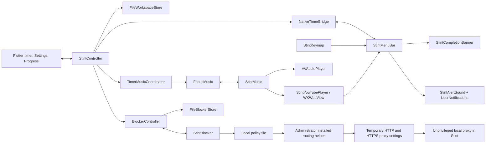

# Stint architecture

Stint uses Flutter for its main interface and AppKit for macOS integration. A single Dart controller owns timer and completion history; native code displays that state and provides system services through method channels. The native countdown calculates from the same deadline so the menu bar can stay responsive between Flutter updates.

[Development](development.md) · [User guide](user-guide.md) · [Contributing](../CONTRIBUTING.md)

## Components

| Location | Responsibility |
| --- | --- |
| [`lib/main.dart`](../lib/main.dart) | Startup, data recovery UI, service lifetime, navigator and appearance. |
| [`lib/data/models.dart`](../lib/data/models.dart) | Serializable workspace, validated settings, timer, rhythms, and compatibility models. |
| [`lib/data/controller.dart`](../lib/data/controller.dart) | Timer transitions, confirmations, completion records, persistence requests, and Progress cache. |
| [`lib/data/store.dart`](../lib/data/store.dart) | File-backed and in-memory stores; atomic replacement and previous-save recovery. |
| [`lib/data/progress.dart`](../lib/data/progress.dart) | Calendar grouping, weekly totals, streaks, goals, and focus-time formatting. |
| [`lib/focus_profiles.dart`](../lib/focus_profiles.dart) | Local profile snapshots, atomic file persistence, confirmed application and compensation across timer, music and blocker configuration. |
| [`lib/ui/ambient_mixer.dart`](../lib/ui/ambient_mixer.dart) | Independent ambient layer controls sharing the native music service. |
| [`lib/native_timer.dart`](../lib/native_timer.dart) | Native timer snapshots and validated commands coming back to Dart. |
| [`lib/music.dart`](../lib/music.dart), [`lib/timer_music.dart`](../lib/timer_music.dart) | Music view state, commands, and timer transition coordination. |
| [`lib/alert_sounds.dart`](../lib/alert_sounds.dart), [`lib/keymap.dart`](../lib/keymap.dart) | Typed alert and shortcut settings interfaces on the timer channel. |
| [`lib/blocker.dart`](../lib/blocker.dart) | Focus-only blocker policy, session override, native updates, and website helper setup state. |
| [`lib/blocking/`](../lib/blocking/) | Validated app/domain models and atomic blocklist storage. |
| [`lib/ui/blocker_settings.dart`](../lib/ui/blocker_settings.dart) | Blocklist draft, confirmations, helper status, and explicit setup/removal controls. |
| [`lib/ui/`](../lib/ui/) | Timer, cycle track, settings, shortcuts, music, and Progress widgets. |
| [`macos/Runner/StintMenuBar.m`](../macos/Runner/StintMenuBar.m) | Status item, timer panel, notification scheduling, action routing, completion coordination. |
| [`macos/Runner/StintCompletionBanner.m`](../macos/Runner/StintCompletionBanner.m) | Branded completion card and first-close hint. |
| [`macos/Runner/StintAlertSound.m`](../macos/Runner/StintAlertSound.m) | Cached two-chime sounds for system notification fallback. |
| [`macos/Runner/StintKeymap.m`](../macos/Runner/StintKeymap.m) | Shortcut validation, registration, recording and saved preferences. |
| [`macos/Runner/StintMusic.m`](../macos/Runner/StintMusic.m) | Import library, local playback, fades, selection, and YouTube coordination. |
| [`macos/Runner/StintYouTubePlayer.m`](../macos/Runner/StintYouTubePlayer.m) | Visible embedded playback, WebKit lifecycle, and stale-event protection. |
| [`macos/Runner/StintBlocker.m`](../macos/Runner/StintBlocker.m) | App selection, activation observation, cooperative hiding, app focus screen, and website helper bridge. |

Two hosts wire up these same services. [`MainFlutterWindow.swift`](../macos/Runner/MainFlutterWindow.swift) belongs to the standard Flutter/Xcode app. [`scripts/local_macos_runner.m`](../scripts/local_macos_runner.m) is the Command Line Tools development host. Both must remain aligned when channel setup, window lifecycle, or service wiring changes.

## Timer ownership and recovery

`StintController` loads a `Workspace`, settles its timer immediately, and ticks once per second. A running timer has an absolute `endsAt` deadline and a session ID. Remaining time is derived from the deadline, bounded between zero and the interval's total, rather than repeatedly subtracting one second from a counter.

Pause captures remaining time and removes the deadline. Resume creates a deadline from that remaining time. At expiry, only a focus interval creates a `FocusSession`. The session uses the timer ID to avoid duplicate records and stores the deadline as a UTC completion instant. The next cycle position is prepared **idle**. A late wake or launch therefore completes the pending interval once; it does not simulate a series of unattended intervals.

Cycle steps are 0–7: even positions are focus, odd positions are short breaks except position 7, the long break. The cycle position is explicit; it is not inferred from total historical completions. Older saves without a cycle step derive a compatible one during decoding.

Reset, Skip, cycle jumps, and rhythm replacement go through a shared `PendingTimerAction` if the interval has progress. The pending action records the interval revision. Expiry or replacement invalidates that context before a delayed confirmation can affect another interval. Confirmation is transient UI state and is not persisted.

Current-interval minute adjustments preserve elapsed time and update the active deadline. Saved duration changes affect later intervals. Applying a rhythm explicitly prepares focus, while saving Settings alone leaves the current timer intact.

## Native method channels

Flutter and native code use the `stint` namespace and the standard method codec. Both ends changed together in version 0.1.1; there are no old channel aliases. Use actual Boolean values on the native side rather than integer-shaped flags.

| Channel | Direction / calls | Owner |
| --- | --- | --- |
| `stint/files` | Dart asks `dataDirectory`. | Host resolves and creates the app's Application Support folder. |
| `stint/timer` | Dart sends `update` snapshots; native sends toggle/reset/skip/jump/rhythm/confirmation/Progress/Settings and music-panel actions. | `NativeTimerBridge` and `StintMenuBar`. |
| `stint/timer` | Alert choices, preview and save; shortcut load/save/record/cancel. | `AlertSounds`, `StintKeymap`, native helpers. |
| `stint/music` | Dart requests load/import/select/play/pause/fade/volume/YouTube operations; native publishes state or error. | `FocusMusic` and `StintMusic`. |
| `stint/blocker` | Dart sends `update`, `chooseApps`, `filterStatus`, and explicit `enableFilter` / `removeFilter`; native sends confirmed `unblock` with a session ID, `status`, and `filter` updates. | `BlockerController` and `StintBlocker`. |

The timer snapshot includes phase, deadline, remaining and total time, IDs, cycle position, saved durations, appearance, pending confirmation, rhythms, daily progress, and optional music state. JSON-equivalent snapshots are suppressed to avoid redundant method calls.

Native controls call back into Dart instead of mutating a second persistent timer. Toggle requests include the state shown by the button so a queued Pause cannot start a newly offered break. Notification actions include the completed session and offered cycle step. Dart accepts them only while that exact offered interval remains untouched and idle.

`NativeTimerBridge` owns the native-to-Dart method handler for the timer channel. Alert and keymap clients invoke methods on the same channel without replacing that handler.

## Alerts and completion cards

`StintMenuBar` maintains an expiry gate keyed to the current interval. It can notice expiry before or after Dart; either ordering must produce one completion presentation and one two-play chime. Pause, reset, replacement, stale callbacks, and overdue launch restoration must not produce duplicate or obsolete alerts.

While Stint runs, direct audio supplies the chime, the branded card supplies the banner, and UserNotifications keeps a passive/list-only record. A normal termination replaces the pending system request with an audible active notification under the same identifier. The native sound helper creates a cached WAV containing two copies of an allowed macOS alert sound with a 250 ms gap. These generated files are local runtime caches, not redistributed sound assets.

The card and system notification derive from the same completion metadata: next step, durations, count, goal, title, and available action. Metadata edits refresh the pending request without changing its deadline. A real completion card is nonactivating; a deliberately requested preview may take keyboard focus. Preview actions dismiss without starting a timer or recording history.

A first-window-close hint and a completion card have different lifetimes. The hint is temporary, with hover/focus deferral; completion remains until dismissal or invalidation. Opening the timer panel hides the card and restoration respects whether the original completion is still current.

## Music and asynchronous intent

`FocusMusic` is the Flutter-facing state and command layer. `StintMusic` owns actual playback and native preferences. Local music uses `AVAudioPlayer`; imports are copied, size-checked and decoder-validated before a batch is committed. Selection stops existing playback. Built-in assets are passed to native playback when needed, while imported files are resolved in the app's library.

`TimerMusicCoordinator` observes **transitions** in phase, running state, and session ID. It does not autoplay during construction and does not react to ordinary ticks. When Play with timer is enabled, any running phase requests play, and an idle phase requests pause. Manual music pause remains respected between transitions.

Generation checks, queued intent, and busy-state handling prevent an old asset load or fade from reversing a more recent Pause or Resume. Turning the option off cancels pending linked intent without taking over manual playback.

YouTube uses the official IFrame API in a `WKWebView` attached to the menu bar panel. The URL parser passes an 11-character video ID instead of arbitrary input URLs. The player uses page tokens and intent versions to reject events from stale loads. Visibility gates playback; closing/hiding the panel pauses it. WebKit media suspension is paired so repeated hide/show does not accumulate suspensions. Showing the panel alone does not resume the video.

## Keyboard shortcuts

`StintKeymap` stores four actions: `toggle`, `reset`, `skip`, and `panel`. Each binding is disabled or contains a virtual key code plus normalized modifier bits: Control=1, Option=2, Shift=4, Command=8. Native validation derives the display label and rejects unsupported, duplicate, or reserved chords. At least Control or Command is required.

Global scope registers Carbon hotkeys; app-only scope uses a local AppKit event monitor. Recording is explicit and local to Stint, temporarily suspends action dispatch, and ends on Escape, app deactivation, cancellation, or disposal. It does not log arbitrary input. Captured keys and repeated key events are suppressed so recording or holding a chord cannot repeatedly invoke a timer action.

Saving attempts the new registration before committing preferences. If registration fails, attempted registrations are removed and the previous configuration is restored. A restoration failure is reported rather than hidden. Reset and Skip route through the same confirmation path as visible buttons; the native panel is shown to expose that confirmation.

The Flutter editor owns a draft and saves independently of parent Settings drafts. Global registration/routing is automated-tested; physical global delivery remains a separate live check.

## App and website blocking

The blocker is included in version 0.2.0 beta. The older 0.1.1 package does not include it. [The setup guide](blocking.md) covers the user-facing flow.

`BlockerController` listens to the existing timer. Effective protection requires a loaded, enabled blocklist, a running focus interval, a future deadline, and a session ID that has not been bypassed. Breaks, pauses, reset, skip and expiry release protection. A confirmed early override is stored against the current session ID, so it survives pause/resume without affecting the next session. A stale native or dialog confirmation cannot unblock a newer session.

The editor saves its enabled setting, apps and domains together before changing policy. A failed write leaves the previous blocklist effective. Timer-driven release does not depend on a successful settings write. Removing protection during an active stint asks for confirmation. Repeated editor requests share one dialog so an older draft cannot remain behind a newer editor.

Native `NSWorkspace` activation observation compares bundle identifiers with the selected apps. `NSRunningApplication.hide()` preserves the process and its documents; Stint never force quits selected apps. A native focus screen gives a countdown and confirmed escape. Native deadline and lease guards release stale protection independently of the Dart tick. Recovery utilities, Stint, Chrome and Edge are excluded from app selection, and hide failures are reported to Dart. Neither Accessibility access nor a privileged helper is used.

### Local website proxy and routing helper

`StintWebsiteBlocker` owns `StintLocalProxy` on IPv4 loopback port 48197 and atomically writes version 2 focus policy to `~/Library/Application Support/Stint Website Blocker/policy.json`. The app's scoped home relative sandbox exception allows this folder. Policy contains session, UID, domains, deadline, issue time, a maximum 30 second lease, proxy port and a per launch health token. Dart renews every ten seconds. A version 1 installed helper is shown as needing an upgrade.

The unprivileged proxy supports a single HTTP request per connection on port 80 and opaque CONNECT tunnels on port 443. It checks domain label boundaries and closes handled tunnels when they become blocked. It bounds headers, buffers, connection count and timeouts. HTTPS bytes are relayed unchanged. Local health checks authenticate the running listener using its token. The app has ordinary network client and server sandbox entitlements, without Network Extension or Apple Events capabilities.

Setup and removal reveal the bundled command in Finder. The user explicitly opens it and enters their administrator password in Terminal. `StintHostsHelper` retains its existing installation identifier to upgrade one daemon. It validates the owning UID and secure policy path, expires policy by wall and monotonic clocks, ignores startup policy until refreshed, and probes the local server before routing. It never parses internet traffic. Its status is root owned, version 2, and checked for freshness by the app.

`StintProxyPreferences` uses SystemConfiguration to change only the HTTP and HTTPS proxy keys of eligible enabled network services. It refuses an existing enabled proxy or unsupported exception list. It saves exact original key presence and values to a root owned recovery journal before committing. Restoration preserves external edits and removes the journal only after commit and apply succeed. Network changes during a focus release routing and require a new focus to retry.

The daemon restores previous settings on inactive or stale policy, server failure, shutdown and restart. Permanently disabling it can leave the selected proxy in place; see [manual recovery](blocking.md#remove-or-recover-the-helper). `StintHostsFile` is retained only for removing the earlier preview's marked hosts entries on upgrade and recovery, preserving unrelated bytes and metadata.

System proxy settings affect all users of the network service. Apps ignoring those settings are outside protection. Preloaded content and buffered media remain visible, and already running direct streams may continue. No URL, payload or DNS activity is logged. See [verification](testing.md#blocker-preview-verification-020-source).

## Persistence and compatibility

Version 0.1.1 uses **Stint** throughout its application identity:

- Bundle identifier: `io.github.albert2704.stint`.
- Dart package and channel prefix: `stint`.
- Application Support subdirectory: `Stint`.
- Native classes and preference keys beginning with `Stint`.
- App executable: `Stint`; Flutter application widget: `StintApp`.

This is a deliberate identity break from version 0.1.0. The app starts with fresh settings, timer/history, imported music and saved YouTube links, shortcuts, and macOS permissions. It does not read or migrate the previous identity's data, and it does not delete that data. Quit the previous app before opening 0.1.1 to avoid two running timers or competing shortcuts.

Both hosts ask macOS for the user Application Support URL and append `Stint`. Because the app is sandboxed, the resolved location may be within its application container; do not hardcode a particular home-directory path. Current native preferences belong to `io.github.albert2704.stint`, with keys such as `StintMusicTracks`, `StintMusicFollowTimer`, and `StintKeyboardShortcuts`.

| Storage | Contents |
| --- | --- |
| `Stint/workspace.json` beneath the resolved Application Support directory | Versioned workspace: timer, duration/appearance settings, custom rhythms, daily goal, focus sessions, and preserved legacy records. |
| `workspace.backup.json` beside it | Previous valid workspace saved before replacing the current file. |
| `workspace.json.damaged-*` beside it | Preserved corrupt input encountered while saving recovery data. |
| `Stint/blocker.json` | Separate versioned enabled setting, selected app names/IDs and domains, and the current-stint override. |
| `Stint/Music/` | App-owned imported audio copies and built-in playback cache files. |
| Native `NSUserDefaults` domain | Music list/selection/volume/follow option, alert choice, hint state, and `StintKeyboardShortcuts`. |
| macOS-resolved Library `Sounds/` | Generated two-chime notification WAV cache. |
| WebKit-managed website storage | Embedded-player web data, outside the Dart workspace JSON. |

`FileWorkspaceStore.save` validates the encoded workspace, writes and flushes a temporary file, stages a valid previous file as the backup, and atomically renames the new file into place. If the current file is malformed, it preserves those bytes instead of overwriting the known-good backup. The startup error screen offers **Recover previous save** when a backup exists. This is one previous save, not a full version history.

The JSON schema remains version 1. Decoding validates duration bounds, identifiers, references, cycle/phase agreement, and timer invariants. Optional newer fields receive compatibility defaults. Legacy projects, tasks, notes, and their references remain round-trippable even though the current UI exposes only Pomodoro and music. This schema compatibility does not import a workspace from the previous app identity. Do not remove those record types without an explicit migration plan.

Blocker storage is separate and does not change the workspace schema or identity. It validates limits of 100 apps and 200 domains, excludes protected app IDs, and rejects malformed or duplicate saved entries. Saving uses a flushed temporary file and atomic rename. It does not use the workspace's previous-save backup.

The proxy replacement preserves version 1 `blocker.json`, with matching covering each domain and its subdomains. Old `browser-pairing.json` files and exported extension folders are ignored and left untouched. Their owner can remove them and any previously installed extension manually; the app does not delete user data during this change.

Progress is derived from saved completed focus records, grouped by the local day of completion. The current goal and locale week start are view preferences. Aggregates are cached across countdown ticks and invalidated for history, local-day, or timezone changes. Goals are not stored historically; changing today's target also changes how past goal days are classified.

## Privacy and platform boundaries

There is no Stint account, hosted app backend, cloud sync, analytics client, or remote workspace upload in the current source. Core timer, progress, bundled audio, and local imports work without an internet connection after installation. Browser inspection uses local macOS Apple Events. Local data is not separately encrypted by Stint; it relies on the operating system's user and disk protections.

YouTube is a network-dependent third-party embed. Loading it contacts YouTube and may use cookies or other WebKit storage under that service's behavior. A privacy-enhanced input URL is parsed to a video ID; it does not switch the implementation to a separate privacy-enhanced player mode. Do not describe the entire app as making no network requests.

Entitlements enable sandboxing, user-selected file access, and network client access. No Automation, Network Extension or system-extension installation entitlements are present. A narrowly scoped home-relative file exception permits the helper settings directory. Website helper installation requires an explicit administrator-approved Terminal command. No release network-server entitlement, Accessibility access or JavaScript from Apple Events is used. The debug profile retains its development JIT and network-server capabilities. Global shortcuts use registered keys and explicit local recording; they do not add an event tap or broad keyboard-monitoring permission flow.

Although much Dart logic can be reused on another platform, the filesystem channel, menu panel, alerts, audio import/playback, YouTube host, keymap, and app-blocking service need platform implementations. Android is an architectural possibility, not an implemented feature.

## Public website

The [Stint website](https://stint-focus.vercel.app/) is a separate static HTML, CSS, and JavaScript site hosted on Vercel. It presents the app's features, illustrative animations, FAQs, and links to GitHub release downloads. It is not a Flutter web build or a browser client for the timer.

Its countdown and sound bars are visual demonstrations. The only saved browser preference is the light/dark selection, stored as `stint-theme`; it does not share settings, music, or history with the Mac app. Theme selection starts from the system preference, and decorative motion respects Reduce Motion. See [website privacy](privacy.md#public-website).

Website deployment and Mac release packaging are separate. Publishing an app release does not automatically update the website's download URL or displayed version; see [release website maintenance](development.md#keep-the-website-in-sync-with-a-release).

## Verification boundaries

[Testing and verification](testing.md) distinguishes source/harness coverage, actual app UI checks, and unverified behavior. Keep that distinction when extending the app, especially for full Xcode packaging, post-Quit system sound, physical Mac-wide shortcuts, and external YouTube behavior.

The [privacy notes](privacy.md) describe local storage and the optional YouTube connection. The current source supersedes the former board, note, and desktop-pet interfaces; compatibility records alone do not make those features part of the present product.
