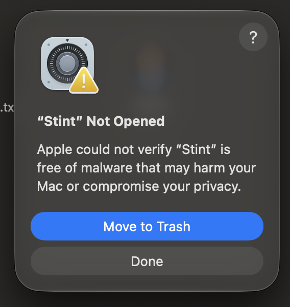

# Install Stint

Stint v0.2.0-beta.1 targets macOS 12 or later, with a universal app for Apple Silicon and Intel. Its CI, universal package, runner startup and local Apple Silicon release app checks passed. Physical Intel and macOS 12 testing have not been completed; see [verification details](testing.md#downloadable-package-verification).

The download includes the app and its runtime. You do not need Flutter, Xcode, or developer tools to use it. See [build from source](development.md) if you want to build Stint yourself.

## Choose a download

Choose Download for Mac on the [Stint website](https://stint-focus.vercel.app/#download), or use the GitHub links below, for the blocker beta. The earlier [0.1.1 preview](https://github.com/albert2704/stint/releases/tag/v0.1.1) remains available without the blocker.

You can find these files under **Assets** on the [Stint v0.2.0-beta.1 release page](https://github.com/albert2704/stint/releases/tag/v0.2.0-beta.1):

| File | Use |
| --- | --- |
| [Stint-0.2.0-macos-universal.dmg](https://github.com/albert2704/stint/releases/download/v0.2.0-beta.1/Stint-0.2.0-macos-universal.dmg) | Recommended. Open the disk image, then copy Stint to Applications. |
| [Stint-0.2.0-macos-universal.zip](https://github.com/albert2704/stint/releases/download/v0.2.0-beta.1/Stint-0.2.0-macos-universal.zip) | Alternative archive containing the same app. |
| [SHA256SUMS.txt](https://github.com/albert2704/stint/releases/download/v0.2.0-beta.1/SHA256SUMS.txt) | Checksums for checking the downloaded archives. |

The GitHub **Source code** archives contain the project source, not an app ready to open.

**This is a prerelease with an ad hoc signature. It is not signed with an Apple Developer ID and is not notarized by Apple.** A successful checksum comparison does not establish developer identity or Apple approval. Expect a Gatekeeper warning on first launch.

## Install the app

1. You can download the DMG from the release page and open it in Finder.
2. Drag **Stint.app** into **Applications**.
3. Eject the Stint disk image, then open Stint from Applications.

If you prefer the ZIP, double click it in Finder to extract **Stint.app**, then move the app into Applications and open it there.

If an earlier Stint is running, choose **Stint → Quit Stint** before replacing it or opening the beta. Closing the window alone keeps the app running in the menu bar. Keep one copy open at a time to avoid duplicate timers and shortcut conflicts.

## First launch and Gatekeeper

This beta has an ad hoc signature, without an Apple Developer ID signature or Apple notarization. On first launch, you may see **“Stint” Not Opened** and this message:

> Apple could not verify “Stint” is free of malware that may harm your Mac or compromise your privacy.



This message means Apple cannot verify the app. It does not say that malware was detected, and it is not an assurance that the download is safe. Only continue if you trust the project and obtained your copy from the [official Stint release page](https://github.com/albert2704/stint/releases).

If you choose to open that copy:

1. You can select **Done** in the warning to keep the app.
2. Open **System Settings → Privacy & Security**.
3. Scroll to **Security** and select **Open Anyway** beside the message about Stint.
4. Confirm **Open** or **Open Anyway** if prompted, and authenticate with your Mac login password or Touch ID if requested.

macOS saves an exception for this app, so you can open it normally afterward. You do not need to disable Gatekeeper for all apps or run a Terminal command. Follow [Apple's instructions](https://support.apple.com/en-us/102445); labels can differ by macOS version.

**No Open Anyway button?** You can try opening Stint from Applications again, then return to Privacy & Security. The option is available for about an hour after a blocked launch. A Mac managed by your organization may prevent this exception; see [Apple's security settings guide](https://support.apple.com/guide/mac-help/mh40617/mac).

**A different warning?** A message that the app **“will damage your computer”**, contains malware, or is **“damaged and can't be opened”** is not the verification warning shown above. Do not use these steps to dismiss it. Stop and report the exact message. [Apple explains the different warnings](https://support.apple.com/en-us/102445).

Removing this verification warning from future public downloads requires a release signed with an Apple Developer ID and notarized by Apple. The current beta does not provide that verification.

## Optional checksum check

You can download `SHA256SUMS.txt` alongside your chosen archive and compare its listed SHA256 value with Terminal's output. For example, from the folder containing the DMG:

```sh
shasum -a 256 Stint-0.2.0-macos-universal.dmg
```

For the ZIP:

```sh
shasum -a 256 Stint-0.2.0-macos-universal.zip
```

The complete 64-character value should match the line for that filename in `SHA256SUMS.txt`. If it does not, download the archive again before opening it.

## Start your first session

Choose a rhythm and press **Start focus**. The countdown remains in the menu bar when you close the window. You can allow notifications when macOS asks and choose your alert in Settings. Music is optional; **Play with timer** starts and pauses your selected source with the timer.

Your timer, progress, and imported music stay local. YouTube links need an internet connection and a visible player inside the timer panel. See the [user guide](user-guide.md), [privacy notes](privacy.md), and [troubleshooting](troubleshooting.md) for details.

## Optional app and website blocking

You can open **Settings → Block distractions**, enable **Block during focus**, choose apps and add website domains, then save your list. Selected apps are hidden when activated, preserving their unsaved work. Blocking pauses when your timer pauses or takes a break.

Website blocking needs a one time administrator setup. **Set up website blocker** highlights **Install Website Blocker.command** in Finder. Double click it, type `yes` when prompted and enter your administrator password in Terminal. Stint does not receive your password. Return to Stint and choose **Refresh**. This also upgrades the earlier helper used by source previews.

No Apple Developer subscription or browser extension is needed. Edge blocking and recovery were tested; Chrome has not been tested for this beta. Browsers must use macOS proxy settings. Existing custom proxies and VPN configurations are unsupported, and loaded pages or buffered media can remain visible. The proxy settings apply to all accounts using those network services, including Stint's YouTube music. See [setup, limits and recovery](blocking.md).

## Updates and removal

Stint does not yet have an automatic updater. You can check the [release page](https://github.com/albert2704/stint/releases), quit the running app, and replace it in Applications with the newer version. Review that version's release notes first.

**From 0.1.1 to 0.2.0 beta:** the app identity and data locations are unchanged. A local replacement with the exact release app preserved the existing progress, music and timer. If you installed an older website helper from source, use **Set up website blocker** to upgrade it before relying on website blocking. A downloaded app upgrade through Gatekeeper remains unverified.

**From 0.1.0:** version 0.1.1 and later start fresh when replacing 0.1.0. Its new identity is `io.github.albert2704.stint`, with a `Stint` data folder and Stint preferences. Your timer/history, custom rhythms, music imports and saved YouTube links, settings, shortcuts, and permissions are not carried over. The previous saved data is left untouched and is not imported automatically. There is no migration action in the app.

When upgrading from 0.1.0, choose your rhythm and music again and allow notifications when prompted. You can keep a copy of your previous data before replacing the app; see [data storage](architecture.md#persistence-and-compatibility).

If you installed the website helper, use **Block distractions → Remove helper** and complete the highlighted removal command before deleting Stint. This restores Stint's proxy changes and removes its background service. Removing the app alone does not uninstall that service. See [helper removal and emergency recovery](blocking.md#remove-or-recover-the-helper).

You can then quit Stint and move the app from Applications to the Trash. Saved data may remain in its macOS container and preferences. Removing the app is not an erase-all-data action; see [privacy and local data](privacy.md#removing-data).
