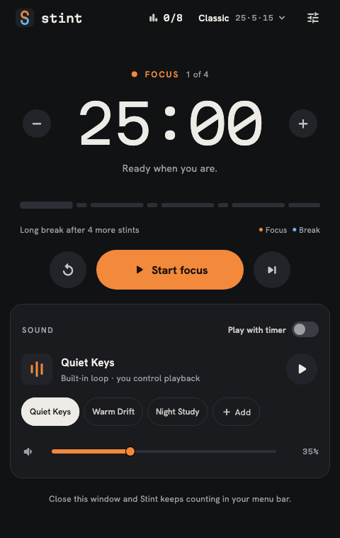
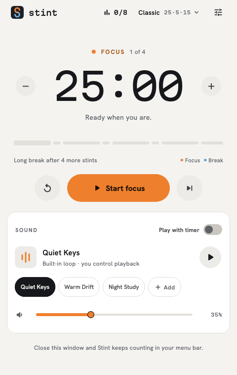
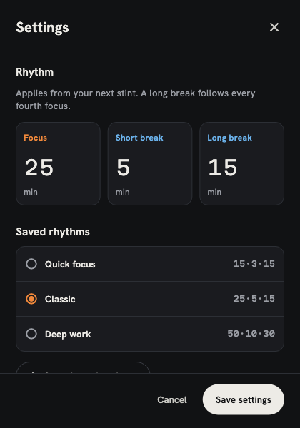
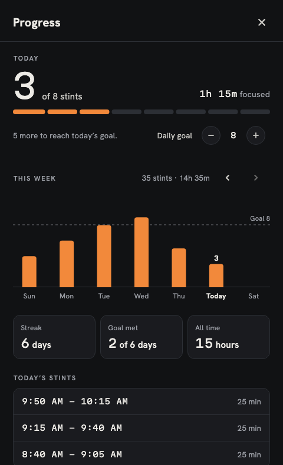

# Stint images and video

These media assets show the current Stint app with synthetic data from Flutter widget tests. They contain no personal desktop content or real session history.

| File | Description |
| --- | --- |
| `stint-overview.png` | 1280×720 README hero: actual dark timer, Stint branding, and the focus/rest/repeat message. |
| `demo.mp4` | 25-second feature overview with the original Quiet Keys music bed at 1280×720 and 30 fps. |
| `demo.gif` | Smaller 800×450 looping version for inline README playback. |
| `stint-dark.png` | Timer and sound controls in dark appearance. |
| `stint-light.png` | Timer and sound controls in light appearance. |
| `stint-settings.png` | Adjustable focus/break durations and saved rhythms. |
| `progress-dark.png` | Synthetic daily goals, weekly totals, streaks, and completed stints. |
| `progress-light.png` | The same progress surface in light appearance. |

The animated overview uses a filling timer/cycle accent, moving callouts, a waveform, screenshot pushes, progress marks, and feature transitions. These illustrations stay outside the unmodified app captures. It moves through five scenes: focus, rhythms, music, progress, and open-source contribution. It is a designed feature overview using genuine app screenshots, not a live interaction recording. The music screenshot leaves “Play with timer” off while the accompanying copy explains enabling it.

Editable source and regeneration instructions are in [`tooling/video`](../../tooling/video/README.md). Original app captures are generated by `test/pomodoro_ui_test.dart` and `test/progress_test.dart`. Original Stint media is MIT licensed; bundled fonts and rendering dependencies keep their own licenses as documented in the source directory.

## Screenshot gallery

### Timer and sound

<table>
<tr><th>Dark appearance</th><th>Light appearance</th></tr>
<tr><td></td><td></td></tr>
</table>

### Rhythms and progress

<table>
<tr><th>Settings</th><th>Progress</th></tr>
<tr><td></td><td></td></tr>
</table>

[View the progress screen in light appearance](progress-light.png).

## Music

The MP4 includes Stint’s original **Quiet Keys** track, with a 0.8-second fade-in and a 1.3-second fade-out. Its source is frozen in the editable video project. This is original synthesized music distributed with Stint under MIT, not a third-party recording. The looping GIF has no audio.
